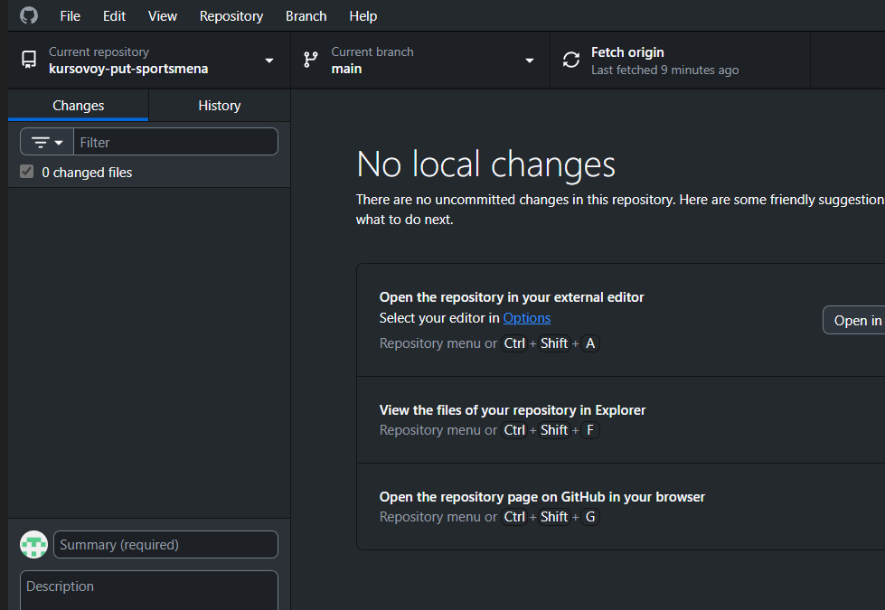
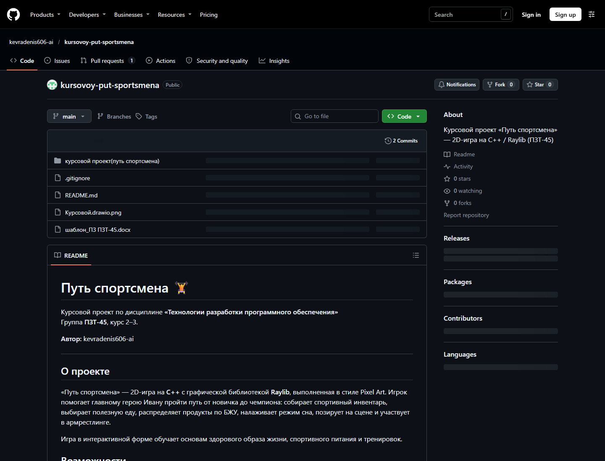
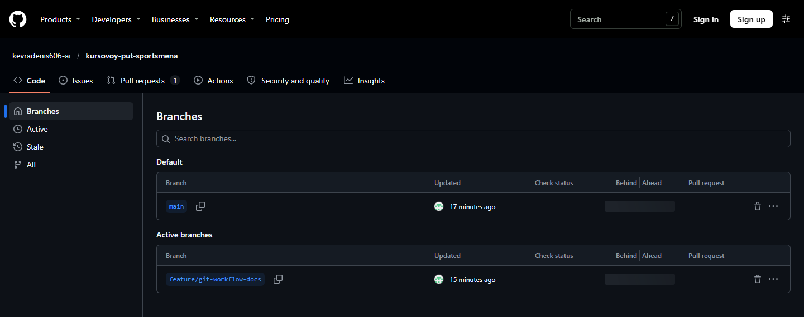
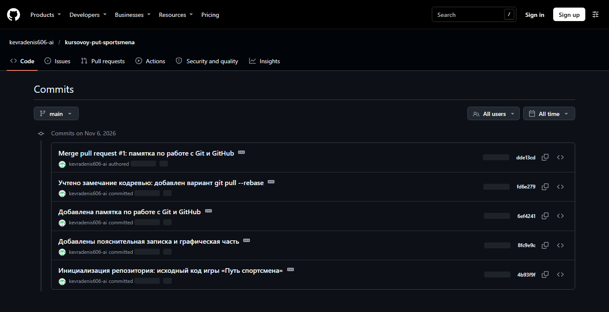
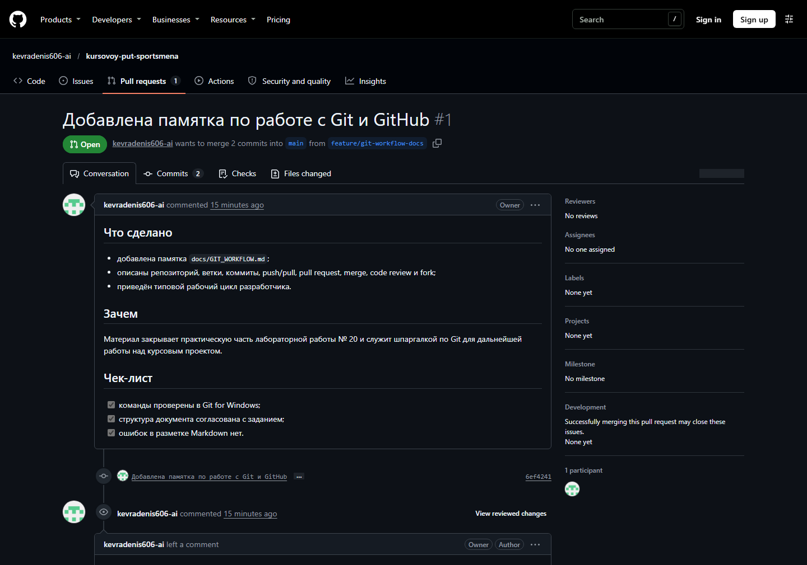
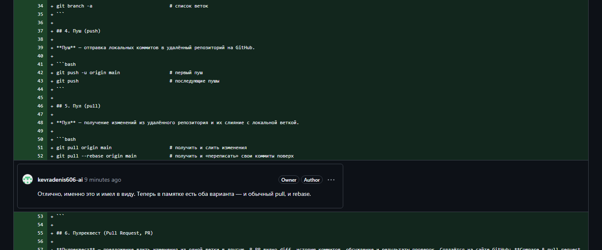
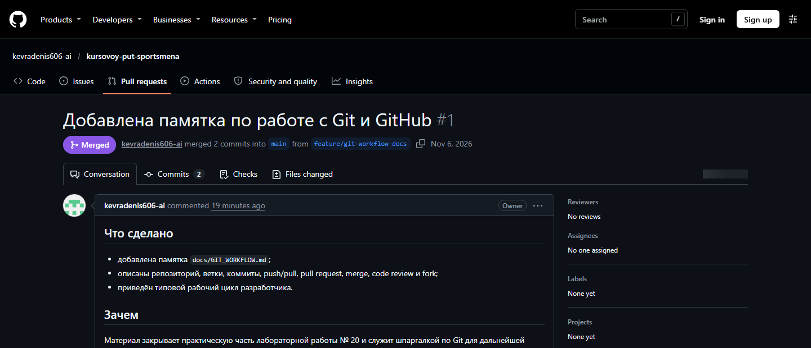
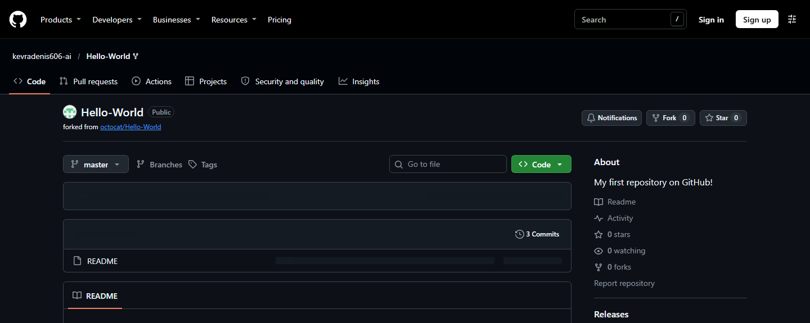
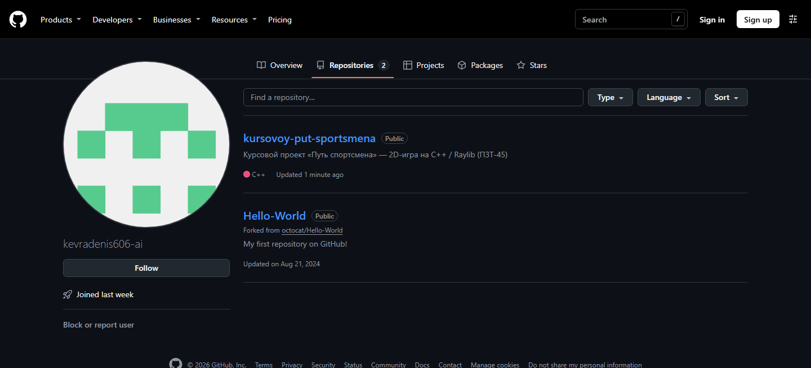

# ОТЧЁТ

## по лабораторной работе № 20

### «Изучение систем контроля версий GIT, GITHUB, GitLAB и др.»

**Выполнил:** kevradenis606-ai  
**Группа:** ПЗТ-45  
**Дата:** 06.11.2026

---

## 1. Цель работы

Изучить назначение и принципы работы систем контроля версий, освоить базовые возможности Git и сервиса GitHub, а также применить их на практике: разместить курсовой проект в удалённом репозитории и продемонстрировать типовые действия с проектом (создание репозитория, веток, коммитов, пулреквестов, кодревью, мерджа и форка).

---

## 2. Теоретическая часть

### 2.1. Назначение систем контроля версий

Система контроля версий — это программный инструмент, который хранит историю изменений файлов проекта и позволяет управлять этими изменениями. Она решает несколько задач:

- **хранение истории** — можно увидеть, кто, когда и что изменил, и вернуться к любой предыдущей версии;
- **совместная работа** — несколько разработчиков могут работать над одним проектом, не мешая друг другу;
- **ветвление и слияние** — параллельная разработка новых функций и экспериментов без риска для основной версии;
- **резервное копирование и восстановление** — потерянный или испорченный файл можно восстановить из истории;
- **аудит и документирование** — каждое изменение сопровождается комментарием, что упрощает сопровождение проекта.

### 2.2. Виды систем контроля версий и их особенности

По архитектуре выделяют три вида CVS:

| Вид | Примеры | Особенности |
|-----|---------|-------------|
| Локальные | RCS, SCCS | Хранят историю только на одном компьютере; подходят для одиночной работы, но не для командной. |
| Централизованные | CVS, Subversion (SVN), Team Foundation Server | Есть единый сервер с репозиторием; клиенты получают файлы по сети. Плюс — простое администрирование, минус — зависимость от сервера и сети. |
| Распределённые | Git, Mercurial, Bazaar | Каждый разработчик имеет полную копию репозитория с историей. Можно работать автономно, а обмен изменениями выполнять через удалённые репозитории. |

### 2.3. Особенности подхода Git к работе с данными и его преимущества

Git — распределённая система контроля версий, созданная Линусом Торвальдсом в 2005 году. В отличие от систем, которые хранят набор изменений (дельт) для каждого файла, Git рассматривает историю проекта как последовательность **снимков (snapshots)** всего дерева файлов. Если файл не изменился, Git просто ссылается на его предыдущую версию, поэтому хранение получается компактным.

Ключевые особенности Git:

- **распределённость** — у каждого разработчика есть полная копия репозитория вместе с историей;
- **целостность** — каждый объект идентифицируется криптографическим хешем SHA-1, поэтому случайно повредить или незаметно подменить данные практически невозможно;
- **локальные операции** — коммиты, просмотр истории, ветвление и слияние выполняются без обращения к серверу и работают быстро;
- **лёгкие ветки** — ветка в Git — это всего лишь указатель на коммит, поэтому создание и переключение веток почти мгновенны;
- **область индексации (staging area)** — позволяет выборочно подготавливать изменения к коммиту;
- **гибкая модель слияния** — поддерживаются merge, rebase, cherry-pick и другие стратегии.

Преимущества Git: высокая скорость, надёжность, возможность работы офлайн, удобная командная разработка через pull request, огромная экосистема (GitHub, GitLab, Bitbucket) и бесплатность.

### 2.4. Процесс установки и настройки Git на ПК

1. Скачать установщик с официального сайта **https://git-scm.com/downloads**.
2. Запустить установку, выбрать компоненты (Git Bash, Git GUI, интеграцию с проводником), способ использования из командной строки и настройки строковых окончаний (`core.autocrlf`).
3. Проверить установку командой:
   ```bash
   git --version
   ```
4. Указать имя и электронную почту автора коммитов:
   ```bash
   git config --global user.name "kevradenis606-ai"
   git config --global user.email "kevradenis606@gmail.com"
   ```
5. При необходимости настроить редактор, ветку по умолчанию и параметры отображения:
   ```bash
   git config --global core.editor "code --wait"
   git config --global init.defaultBranch main
   git config --global core.quotepath false
   ```
6. Проверить настройки:
   ```bash
   git config --list --show-origin
   ```
7. Для работы с GitHub настроить аутентификацию (HTTPS с токеном или SSH-ключ). В данной работе используется GitHub Desktop, который сам выполняет авторизацию и хранит учётные данные в защищённом хранилище Windows.

---

## 3. Сервис GitHub

### 3.1. Назначение GitHub

GitHub — облачная платформа для хранения Git-репозиториев и совместной разработки. Кроме хостинга кода, GitHub предоставляет:

- pull request и кодревью;
- Issues — трекер задач и ошибок;
- Projects — доски и планирование;
- GitHub Actions — CI/CD и автоматизацию;
- GitHub Pages — публикацию сайтов;
- Wiki, Releases, Packages и социальные функции (звёзды, форки, подписки).

### 3.2. Назначение GitHub Desktop

GitHub Desktop — графический клиент Git и GitHub для Windows и macOS. Он позволяет без командной строки:

- клонировать репозитории и создавать новые;
- просматривать изменения и делать коммиты;
- создавать, переключать и сливать ветки;
- выполнять push и pull;
- создавать pull request и переходить к кодревью;
- разрешать конфликты слияния.

GitHub Desktop удобен для начинающих и для наглядной демонстрации работы с Git.

### 3.3. Основные термины

| Термин | Определение |
|--------|-------------|
| **Репозиторий** | Хранилище проекта вместе со всей историей изменений. Состоит из рабочей области и служебной папки `.git`. |
| **Рабочая область и хранилище** | Рабочая область — обычные файлы на диске, которые редактирует разработчик. Хранилище (репозиторий, папка `.git`) содержит объекты Git: коммиты, деревья, блобы и ссылки. |
| **Форк (fork)** | Личная копия чужого репозитория в своём аккаунте. Используется, чтобы предложить изменения в проект, не имея прав записи в оригинал. |
| **Ветка (branch)** | Отдельная линия разработки, указывающая на определённый коммит. Позволяет вести работу параллельно, не затрагивая основную ветку. |
| **Мастер (master/main)** | Основная (стабильная) ветка репозитория. В современных проектах по умолчанию называется `main`. |
| **Коммит (commit)** | Зафиксированное состояние проекта: снимок файлов, автор, дата, сообщение и ссылка на родительский коммит. Имеет уникальный хеш. |
| **Пул (pull)** | Получение изменений из удалённого репозитория и их слияние с локальной веткой (`git pull`). |
| **Пуш (push)** | Отправка локальных коммитов в удалённый репозиторий (`git push`). |
| **Пулреквест (pull request, PR)** | Предложение влить изменения из одной ветки в другую. В PR видны diff, коммиты, обсуждение, проверки и результаты кодревью. |
| **Мердж (merge)** | Слияние двух веток в одну с сохранением истории обеих. |
| **Кодревью (code review)** | Проверка изменений другим разработчиком до слияния: комментарии к строкам, одобрение (Approve) или запрос правок (Request changes). |

---

## 4. Практическая часть

### 4.1. Задание 1. Профиль GitHub и репозиторий курсового проекта

**Профиль GitHub:** https://github.com/kevradenis606-ai  
**Репозиторий курсового проекта:**  
https://github.com/kevradenis606-ai/kursovoy-put-sportsmena

Для выполнения задания:

1. Создан профиль на GitHub (`kevradenis606-ai`).
2. Установлен и авторизован **GitHub Desktop**. В приложение добавлен локальный репозиторий `D:\курсовой` (рис. 1).
3. В репозиторий размещены материалы курсового проекта «Путь спортсмена»:
   - исходный код на C++ (`Source.cpp`), решение Visual Studio (`.sln`, `.vcxproj`), файлы ресурсов и графика (`assets/`);
   - пояснительная записка — `шаблон_ПЗ ПЗТ-45.docx`;
   - графическая часть — `Курсовой.drawio.png`;
   - вспомогательная документация — `README.md`, `docs/GIT_WORKFLOW.md`, `.gitignore`.
4. Репозиторий опубликован на GitHub и связан с локальной папкой (remote `origin`).





Структура репозитория:

```text
kursovoy-put-sportsmena/
├── курсовой проект(путь спортсмена)/   # решение Visual Studio и исходники
│   ├── Source.cpp                       # исходный код игры
│   ├── assets/                          # графика и музыка
│   └── *.sln, *.vcxproj, packages.config
├── docs/
│   ├── GIT_WORKFLOW.md                  # памятка по Git
│   └── screenshots/                     # скриншоты для отчёта
├── шаблон_ПЗ ПЗТ-45.docx                # пояснительная записка
├── Курсовой.drawio.png                  # графическая часть
├── README.md
└── .gitignore
```

### 4.2. Задание 2. Типовые действия с проектом

#### Создание репозитория

Локальный репозиторий создан в папке курсового проекта, после чего привязан удалённый репозиторий на GitHub:

```bash
cd "D:\курсовой"
git init -b main
git add .
git commit -m "Инициализация репозитория: исходный код игры «Путь спортсмена»"
git remote add origin https://github.com/kevradenis606-ai/kursovoy-put-sportsmena.git
git push -u origin main
```

Дополнительно добавлен `.gitignore`, чтобы в репозиторий не попадали служебные файлы Visual Studio (`.vs/`, `x64/`, `Debug/`, `packages/`, `*.obj`, `*.pdb` и т. п.).

#### Создание ветки

Для оформления памятки по Git создана отдельная ветка:

```bash
git switch -c feature/git-workflow-docs
```

В ней добавлен файл `docs/GIT_WORKFLOW.md` с описанием репозитория, веток, коммитов, push/pull, pull request, merge, code review и fork.



#### Коммиты и пуш

Изменения зафиксированы двумя коммитами и отправлены на GitHub:

```bash
git add docs/GIT_WORKFLOW.md
git commit -m "Добавлена памятка по работе с Git и GitHub"
git push -u origin feature/git-workflow-docs
```

История коммитов после выполнения работы:

```text
*   dde13cd Merge pull request #1: памятка по работе с Git и GitHub
|\
| * fd6e279 Учтено замечание кодревью: добавлен вариант git pull --rebase
| * 6ef4241 Добавлена памятка по работе с Git и GitHub
|/
* 8fc9e9c Добавлены пояснительная записка и графическая часть
* 4b93f9f Инициализация репозитория: исходный код игры «Путь спортсмена»
```



#### Пулреквест

Из ветки `feature/git-workflow-docs` в `main` открыт Pull Request № 1 «Добавлена памятка по работе с Git и GitHub». В описании PR указаны цель изменений и чек-лист проверки.



#### Кодревью

В ходе кодревью оставлен комментарий к строке 51 файла `docs/GIT_WORKFLOW.md`: предложено добавить вариант `git pull --rebase`, чтобы избежать лишних merge-коммитов. Замечание было исправлено отдельным коммитом:

```bash
git add docs/GIT_WORKFLOW.md
git commit -m "Учтено замечание кодревью: добавлен вариант git pull --rebase"
git push
```

После повторной проверки оставлен комментарий о том, что замечание устранено и изменения можно сливать.



#### Мердж и пул

Pull Request слит в основную ветку кнопкой **Merge pull request** (merge-коммит `dde13cd`). После слияния изменения получены в локальный репозиторий:

```bash
git switch main
git pull origin main
```



#### Форк

GitHub не позволяет форкнуть собственный репозиторий в тот же аккаунт, поэтому механизм форка продемонстрирован на публичном учебном репозитории `octocat/Hello-World`: создан форк `kevradenis606-ai/Hello-World`, в котором можно вносить изменения и затем предлагать их в оригинал через Pull Request.



#### Профиль GitHub

На рис. 9 показаны оба репозитория в профиле: курсовой проект и учебный форк.



---

## 5. Результаты работы

В ходе лабораторной работы:

- изучены назначение, виды и принципы работы систем контроля версий;
- освоены базовые команды Git и работа с GitHub Desktop;
- создан публичный репозиторий курсового проекта: **https://github.com/kevradenis606-ai/kursovoy-put-sportsmena**;
- в репозиторий размещены исходный код, пояснительная записка и графическая часть;
- продемонстрированы типовые действия: создание репозитория, веток, коммитов, push/pull, pull request, кодревью, merge и fork;
- оформлена памятка по работе с Git (`docs/GIT_WORKFLOW.md`).

---

## 6. Вывод

В результате лабораторной работы были получены практические навыки работы с распределённой системой контроля версий Git и сервисом GitHub. Освоен полный цикл командной разработки: от создания репозитория и ветки до кодревью и слияния изменений. Использование Git позволяет хранить историю проекта, безопасно экспериментировать, организовать совместную работу и поддерживать актуальность курсового проекта. Полученные навыки будут применяться при дальнейшей разработке программного продукта «Путь спортсмена».

---

## 7. Список использованных источников

1. Официальная документация Git. — https://git-scm.com/doc
2. «Git. Базовый курс»: бесплатный онлайн-курс от GeekBrains. — https://gb.ru/courses/1117
3. Работа с Git через консоль — журнал «Доктайп». — https://htmlacademy.ru/blog/boost/frontend/git-console
4. Документация GitHub. — https://docs.github.com
5. Chacon S., Straub B. Pro Git. — Apress, 2014.
